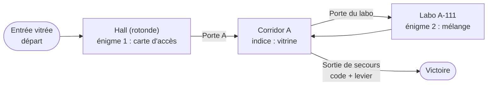

# Plan du laboratoire — version 2 (pavillon Rémi-Rossignol)

**Rôle :** environnement et systèmes
**Statut :** greybox fusionnée (PR #5) ; version réaliste (3 niveaux, portes, ambiance) en cours de validation

La version 1 (3 salles alignées) est remplacée par un décor inspiré du **pavillon Rémi-Rossignol** de l'Université de Moncton : le hall en rotonde, le corridor A et le labo A-111. Les énigmes ne changent pas, seul le décor change.

---

## 1. Conventions d'échelle

| Élément | Valeur | Raison |
|---|---|---|
| Unité Unity | 1 unité = 1 mètre | Échelle réelle, indispensable en VR |
| Origine du suivi | Sol (`Floor`) | Le joueur est à sa vraie hauteur |
| Hauteur sous plafond | Hall 3,5 m · corridor 2,7 m · labo 3,0 m | Proche du bâtiment réel |
| Portes | Double 1,8 × 2,2 m · simple 0,9 × 2,1 m | Tailles réelles des portes coupe-feu et de labo |
| Paillasses et îlots | 0,9 m de haut | Hauteur de travail debout |
| Objets à saisir | entre 0,8 m et 1,5 m du sol | Atteignables sans se pencher |
| Indices à lire | entre 1,4 m et 1,8 m | Lisibilité dans le casque |
| Passages | au moins 1,2 m | Pas de collision avec les murs |

## 2. Vue d'ensemble

Repère Unity (vue de dessus) : x vers l'est, z vers le nord. Centre du hall en (0, 0, 0).

| Zone | Position | Taille |
|---|---|---|
| Hall (rotonde) | centre (0, 0, 0) | cercle de 18 m, escalier au centre (rampe de 6 m) |
| Hall d'entrée | x −5,5 → 5,5 · z 7,1 → 12 | 4 portes vitrées au nord (verrouillées) |
| Corridor A | x 8,8 → 24 · z −1,2 → 1,2 | 15,2 × 2,4 m, sol en damier |
| Labo A-111 | x 12 → 24 · z 1,2 → 10,2 | 12 × 9 m, fenêtres au nord |
| Départ du joueur | (0, 0, 10,5) | face au hall |

## 3. Le hall

Le hall rond existe sur **3 niveaux identiques** (sous-sol, rez-de-chaussée, 2e étage), comme dans le vrai pavillon. Le joueur reste au rez-de-chaussée ; il voit le 2e étage par l'ouverture du plafond et le sous-sol par le puits de l'escalier.

En entrant par les portes vitrées : **A à gauche**, **D à droite**, **B en face à gauche**, **C en face à droite**. Seule la **porte A** du rez-de-chaussée s'ouvre ; les autres sont des doubles portes coupe-feu **fermées** (affiche « ACCÈS FERMÉ — CONFINEMENT »).

| Élément | Rôle |
|---|---|
| Escalier en spirale (sous-sol ↔ 2e étage) | Décor central. Bloqué par le confinement : ruban sur la rampe, panneau d'avertissement, grille fermée en haut |
| Puits vers le sous-sol | Lueur rouge pendant l'alerte |
| Balcon vitré du 2e étage | Enseigne « Bienvenue à la Faculté des sciences » |
| Babillard | **Indice** : code du tiroir du comptoir |
| Comptoir près de la porte A | Tiroir avec la **carte d'accès** |
| Plan d'évacuation | **Indice** : chemin vers le labo A-111 |
| Lecteur de carte, porte A | Ouvre la porte A |
| Fauteuils rouges, bacs de recyclage, fontaine | Décor réaliste |

## 4. Le corridor A

| Élément | Rôle |
|---|---|
| Vitrine des molécules | **Indice** : couleurs de la molécule = ordre des fioles |
| Portes A-108, A-110 | Décor (fermées), avec numéros et panneau « Danger haute tension » |
| Babillards, affiches, extincteur, panneau électrique | Décor réaliste |
| Porte du labo (lecteur de carte) | Ouvre le labo A-111 |
| Cloches d'alarme | Sonnent pendant l'alerte |
| Console (clavier + levier) | Énigme finale |
| Sortie de secours (double porte) | Fin de la partie |

## 5. Le labo A-111

| Élément | Rôle |
|---|---|
| Îlot A | Bécher : zone du mélange |
| Îlot B, paillasse sous les fenêtres | Décor |
| Étagère des fioles (mur ouest) | 5 fioles : 3 utiles, 2 leurres |
| Hotte (mur est) | **Source de la fuite** (gaz vert) |
| Tableau blanc | **Indice** : couleur cible |
| Évier | Vider le bécher pour recommencer |
| Horloge | Emplacement du minuteur |

## 6. Énigmes et indices

| # | Où | Indice | Action | Résultat |
|---|---|---|---|---|
| 1 | Hall | Babillard | Code du tiroir → carte d'accès → lecteur | Porte A s'ouvre |
| 2 | Corridor | Vitrine des molécules | Carte → lecteur du labo | Porte du labo s'ouvre |
| 3 | Labo | Vitrine + tableau blanc | Verser les fioles dans le bon ordre | Fuite arrêtée, code révélé |
| 4 | Corridor | Code du bécher | Clavier puis levier | Sortie ouverte, victoire |

## 7. Réalisme du décor

Faux plafonds en dalles de 60 cm (corridor, labo), plâtre lisse dans le hall, gicleurs, détecteurs de fumée, grilles de ventilation, plinthes brunes, cadres de porte brun foncé, sol en terrazzo (hall), damier rouge et crème (corridor), carrelage beige (labo). Textures générées par code, à leur taille réelle.

## 8. Histoire : « Alerte au labo A-111 »

Le soir, le pavillon est fermé. Le joueur est le technicien de garde ; il reçoit une alerte : *« Capteur de gaz du labo A-111 : niveau anormal. »*

| Étape | Ce qui se passe | Pourquoi c'est logique |
|---|---|---|
| 1. Hall (calme) | Les portes vitrées se verrouillent derrière le joueur (« clac ») | Sécurité de nuit |
| 2. Badge | Babillard → code du tiroir → carte d'accès → porte A | Il faut un badge pour circuler la nuit |
| 3. Corridor (tension) | Près du labo, les néons grésillent et on entend un sifflement derrière la porte | Premiers signes de la fuite |
| 4. Entrée du labo (choc) | La fuite éclate : gaz, gyrophares, cloches. Annonce : « Confinement du pavillon. Décontamination automatique dans dix minutes. » **Le minuteur démarre** | Le capteur confirme la fuite : le bâtiment se ferme |
| 5. Arrêter la fuite | Bon mélange → le gaz s'arrête → l'étiquette du bécher donne le **code de levée du confinement** | Neutraliser le produit |
| 6. Sortir | Console du corridor : code + levier → porte de secours → victoire | Le code lève le confinement |
| Échec | Voile blanc + souffle : « décontamination » | Fin du compte à rebours |

## 9. Ambiance et réalisme

| Moment | Lumière | Son |
|---|---|---|
| Départ | Pavillon calme, néons normaux | « Clac » des portes vitrées, ventilation |
| Corridor, près du labo | Néons du corridor qui grésillent | Sifflement derrière la porte A-111 |
| Entrée du labo | Gyrophares rouges, néons qui grésillent, gaz vert | Cloches, sifflement, annonce de confinement |
| Dernière minute | Gyrophares plus rapides | Sirène |
| Victoire | Néons stables, gyrophares éteints | Alarme coupée |
| Échec | Voile blanc | Souffle de décontamination |

Zones invisibles : `Systemes/Declencheur_Corridor` et `Systemes/Declencheur_Labo` (en orange dans la vue Scene). Éclairage précalculé ; seuls 3 gyrophares utilisent une lumière en temps réel.

## 10. À valider

- [ ] Moment où le minuteur démarre : au début ou à l'entrée du labo (toute l'équipe)

- [ ] Disposition du hall et des portes (toute l'équipe)
- [ ] Positions des énigmes et des points d'interaction (avec Jolin)
- [ ] Zones de téléportation et affichage du minuteur (avec Sarata)
- [ ] Performance dans le casque, 72 images/s minimum (avec Oumar)
