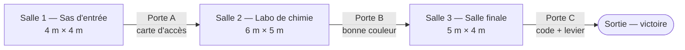

# Plan du laboratoire

**Rôle :** environnement et systèmes
**Statut :** proposition à valider en réunion

---

## 1. Conventions d'échelle

| Élément | Valeur | Raison |
|---|---|---|
| Unité Unity | 1 unité = 1 mètre | Échelle réelle, indispensable en VR |
| Origine du suivi | Sol (`Floor`) | Le joueur est à sa vraie hauteur |
| Hauteur sous plafond | 3,0 m | Évite la sensation d'écrasement |
| Portes | 1,2 m de large × 2,2 m de haut | Passage confortable avec la téléportation |
| Paillasses et tables | 0,9 m de haut, 0,8 m de profondeur | Hauteur de travail debout |
| Objets à saisir | entre 0,8 m et 1,5 m du sol | Atteignables sans se pencher ni lever les bras |
| Écrans et affiches à lire | entre 1,4 m et 1,8 m, à 1 à 2 m du joueur | Lisibilité (conseils Meta : au moins 0,5 m, idéalement 1 m) |
| Largeur des passages | au moins 1,2 m | Pas de collision avec les murs |

## 2. Vue d'ensemble

Les trois salles sont alignées. Le joueur avance d'ouest en est. Chaque porte est verrouillée jusqu'à la réussite de l'énigme de la salle.

Coordonnées proposées (vue de dessus, x vers l'est, z vers le nord) :

| Salle | x | z | Porte de sortie |
|---|---|---|---|
| Salle 1 | 0 → 4 | 0 → 4 | Porte A, mur est (x = 4), centrée en z = 2 |
| Salle 2 | 4 → 10 | −0,5 → 4,5 | Porte B, mur est (x = 10), centrée en z = 2 |
| Salle 3 | 10 → 15 | 0 → 4 | Porte C, mur est (x = 15), centrée en z = 2 |

Point de départ du joueur : (1, 0, 2), face à l'est.

## 3. Détail des salles

### Salle 1 — Sas d'entrée (tutoriel, très facile)

**Énigme :** trouver la carte d'accès et la glisser dans le lecteur de la porte A.

| Élément | Position | Rôle |
|---|---|---|
| Rangée de 4 casiers | mur nord | Un seul casier s'ouvre (poignée) ; la carte d'accès est à l'intérieur |
| Affiche de sécurité | mur sud, 1,6 m | **Indice** : le numéro du bon casier est caché dans l'affiche |
| Lecteur de carte | à droite de la porte A, 1,2 m | La carte glissée ouvre la porte |
| Écran d'accueil | mur ouest, 1,7 m | Présente la mission et le minuteur |

Interactions : saisir (poignée, carte), insérer (lecteur). Locomotion apprise : téléportation.

### Salle 2 — Laboratoire de chimie (facile à moyen)

**Énigme :** mélanger les bonnes fioles dans le bécher pour obtenir la couleur cible ; l'étiquette révèle alors le code de la salle 3 et la porte B s'ouvre.

| Élément | Position | Rôle |
|---|---|---|
| Paillasse centrale | centre de la salle, 2 m × 0,8 m | Zone de travail |
| Étagère de 5 fioles colorées | mur nord, 1,0 à 1,5 m | 3 fioles utiles, 2 leurres |
| Bécher sur un support | sur la paillasse | Reçoit les liquides ; change de couleur |
| Tableau blanc | mur sud, 1,6 m | **Indice** : la « recette » (ordre ou proportions), partiellement effacée |
| Cahier de laboratoire | sur une table au sud-ouest | **Indice** complémentaire (couleur cible) |
| Évier | angle nord-est | Vider le bécher pour recommencer (réinitialisation) |
| Grand écran mural | mur ouest, 1,8 m | Minuteur visible de partout |

Interactions : saisir, verser (inclinaison de la fiole), poser sur un support, vider.

### Salle 3 — Salle finale (difficile)

**Énigme :** entrer le code trouvé en salle 2 sur le clavier, puis abaisser le levier pour ouvrir la porte de sortie.

| Élément | Position | Rôle |
|---|---|---|
| Console de contrôle | face à la porte C, 1,1 m | Porte le clavier et le levier |
| Clavier numérique 3D | sur la console | Saisie du code |
| Levier | à droite du clavier | Action finale ; ne fonctionne qu'après le bon code |
| Écran de la console | au-dessus du clavier, 1,6 m | Affiche le code saisi, les erreurs, l'état |
| Gyrophares | plafond | S'allument en rouge quand il reste peu de temps |

Interactions : appuyer (touches), saisir et tirer (levier).

## 4. Placement des indices

| Indice | Salle | Support | Mène à |
|---|---|---|---|
| Numéro du bon casier | 1 | Affiche de sécurité | La carte d'accès |
| Recette du mélange | 2 | Tableau blanc | L'ordre des fioles |
| Couleur cible | 2 | Cahier de laboratoire | Vérifier le mélange |
| Code final | 2 | Étiquette du bécher (après réussite) | Le clavier de la salle 3 |

Règle : chaque indice est visible depuis un point de téléportation, sans devoir se pencher.

## 5. Téléportation

- Une **zone de téléportation** couvre le sol de chaque salle, sauf sous les meubles.
- Un **point d'ancrage** devant chaque énigme (casiers, paillasse, console), orienté vers elle.
- Les portes fermées bloquent la téléportation vers la salle suivante.

## 6. Ambiance et audio (par salle)

| Salle | Lumière | Son d'ambiance | Sons d'événements |
|---|---|---|---|
| 1 | Blanche, froide | Ventilation | Bip du lecteur, porte qui glisse |
| 2 | Blanche + lueur colorée du bécher | Bourdonnement de laboratoire | Liquide versé, bulles, réussite |
| 3 | Bleutée, puis rouge en fin de temps | Machines, alarme lointaine | Touches, erreur, levier, sirène |

Les sons sont spatialisés (attachés aux objets) pour guider le joueur.

## 7. Prefab de porte (`ZoneDoor`)

| Propriété | Valeur |
|---|---|
| États | Verrouillée → Ouverture → Ouverte |
| Retour visuel | Voyant rouge (verrouillée), vert (ouverte) |
| Retour sonore | Son de déverrouillage + glissement |
| Ouverture | Méthode publique `Open()` appelée par l'énigme de la salle (événement `OnSolved`) |
| Blocage | Le collider empêche le passage et la téléportation tant que la porte est verrouillée |
| Réinitialisation | Méthode `ResetDoor()` pour revenir à l'état verrouillé (nouvelle partie) |

## 8. Histoire narrative (proposition)

Une situation d'urgence sert de point de départ :
une fuite chimique déclenche le confinement du laboratoire. Le joueur, technicien de garde, a 10 minutes pour rétablir l'accès et sortir avant la décontamination automatique.

## 9. À valider

- [ ] Dimensions et ordre des salles (toute l'équipe)
- [ ] Positions des énigmes et hauteur des objets (avec Jolin, interactions)
- [ ] Zones de téléportation et emplacement du minuteur (avec Sarata, locomotion et interface)
- [ ] Histoire narrative (toute l'équipe)
