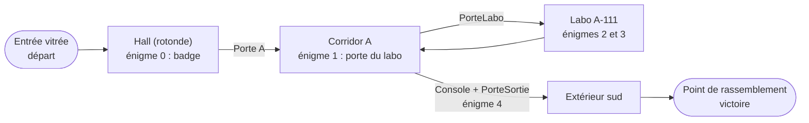

# Plan du laboratoire — version 3 (pavillon Rémi-Rossignol)

**Rôle :** environnement et systèmes (Brunel)
**Statut :** environnement v10 fusionné (PR #9) · GameManager en relecture (PR #10) · énigmes à construire (Jolin)
**Mise à jour :** 25 novembre 2026

Le décor reproduit le **pavillon Rémi-Rossignol** de l'Université de Moncton : le hall en rotonde sur 3 niveaux, le corridor A, le labo A-111 et l'extérieur côté sud (sortie de secours, point de rassemblement, rue). Depuis la version 2, la fin du jeu se passe **dehors** : le joueur gagne en atteignant le point de rassemblement, où arrivent les pompiers.

Tout le décor est construit par le menu **Escape Lab > Construire la greybox du pavillon** (`Assets/_Project/Editor/GreyboxPavillonBuilder.cs`). Relancer ce menu **remplace** tout l'objet `Greybox_Pavillon` : ne rien modifier à la main dedans.

---

## 1. Conventions d'échelle

| Élément | Valeur | Raison |
|---|---|---|
| Unité Unity | 1 unité = 1 mètre | Échelle réelle, indispensable en VR |
| Origine du suivi | Sol (`Floor`) | Le joueur est à sa vraie hauteur |
| Hauteur sous plafond | Hall 3,5 m · corridor 2,7 m · labo 3,0 m | Proche du bâtiment réel |
| Portes | Double 1,8 × 2,2 m · simple 0,9 × 2,1 m | Tailles réelles des portes coupe-feu et de labo |
| Paillasses et îlots | 0,9 m de haut | Hauteur de travail debout |
| Objets à saisir | entre 0,8 m et 1,5 m du sol | Atteignables sans se pencher |
| Indices à lire | entre 1,4 m et 1,8 m | Lisibilité dans le casque |
| Passages | au moins 1,2 m | Pas de collision avec les meubles |
| Prise en main | 35 cm maximum entre la main et l'objet | Pas de saisie à distance (`FiltreProximite`) |

## 2. Vue d'ensemble

Repère Unity (vue de dessus) : x vers l'est, z vers le nord. Centre du hall en (0, 0, 0).

| Zone | Position (monde) | Taille |
|---|---|---|
| Hall (rotonde) | centre (0, 0, 0) | cercle de 18 m, puits de l'escalier de 6 m au centre |
| Hall d'entrée | x −5,5 → 5,5 · z 7,1 → 12 | 4 portes vitrées au nord (verrouillées) |
| Corridor A | x 9,05 → 24 · z −1,2 → 1,2 | 15 × 2,4 m, sol en damier |
| Labo A-111 | x 12 → 24 · z 1,2 → 10,2 | 12 × 9 m, fenêtres au nord |
| Sortie de secours | (23, 0, −1,2) | double porte vers le sud |
| Point de rassemblement | (21,5, 0, −7,4) | zone de 6 × 4,2 m, panneau « POINT DE RASSEMBLEMENT » |
| Rue (pompiers, ambulance) | z −15,5 → −22,5 | chaussée, bordures, 2 lampadaires |
| Départ du joueur | (0, 0, 10,5) | face au hall |

## 3. Le hall

Le hall rond existe sur **3 niveaux identiques** (sous-sol, rez-de-chaussée, 2e étage), comme dans le vrai pavillon. Le joueur reste au rez-de-chaussée ; il voit le 2e étage par l'ouverture du plafond et le sous-sol par le puits.

En entrant par les portes vitrées : **A à gauche**, **D à droite**, **B en face à gauche**, **C en face à droite**. Seule la **porte A** du rez-de-chaussée s'ouvre (`PorteA`, ZoneDoor double) ; les autres sont des portes coupe-feu à battants **fermées** (« ACCÈS FERMÉ — CONFINEMENT »).

| Élément | Rôle |
|---|---|
| Escalier principal (RDC → 2e étage) | Grande volée courbe en bois qui part du bord du puits ; garde-corps reliés et mur invisible des deux côtés. Fermé : ruban et panneau sur la 2e marche, grille cadenassée en haut |
| Escalier du sous-sol | Descend dans le puits dans le même sens de rotation ; portillon cadenassé sous la première marche |
| Garde-corps du puits | Rampe ronde reliée aux escaliers par des poteaux ; on ne peut plus tomber |
| Balcon vitré du 2e étage | Enseigne « Bienvenue à la Faculté des sciences » |
| Comptoirs de chaque côté des portes | Le comptoir à droite de la porte A porte le **tiroir du badge** (`Point_Tiroir_Comptoir`) |
| Babillard | **Indice** de l'énigme 0 (`Point_Indice_Babillard`) |
| Lecteur de carte, porte A | `Point_LecteurCarte_PorteA` |
| Plan d'évacuation | Vrai plan du bâtiment, orienté comme on le regarde |
| Fauteuils rouges, bacs de tri (contre le mur, couvercles qui s'ouvrent), fontaine, gicleurs | Décor réaliste |

## 4. Le corridor A

| Élément | Rôle |
|---|---|
| 2 babillards (feuilles Séminaire, Sécurité, Horaire, Emploi, Club) | **Indices** des énigmes 1 et 3 |
| Vitrine des molécules (éclairée) | **Indice** de l'énigme 2 (`Point_Indice_Molecule`) |
| Armoire à extincteur (s'ouvre) | Extincteur fonctionnel : on le saisit, gâchette = jet de poudre, 12 s |
| Portes A-108, A-110 | Décor (fermées) |
| Porte du labo | `PorteLabo` (ZoneDoor simple) + lecteur `Point_LecteurCarte_Labo` |
| Console (clavier + levier) | Énigme 4 (`Point_Clavier`, `Point_Levier`) |
| Sortie de secours | `PorteSortie` (ZoneDoor double), panneau « SORTIE » |
| Cloches d'alarme, néons | Sonnent et grésillent pendant l'alerte |

## 5. Le labo A-111

Coordonnées dans le repère du labo (coin sud-ouest = (12, 0, 1,2) dans le monde).

| Élément | Position (labo) | Rôle |
|---|---|---|
| Îlot A (6 m) | centre (4,5 ; 3) | Centre réservé au **bécher de l'énigme 2** (`Point_Becher`) ; porte-pipettes, bec Bunsen, évaporateurs rotatifs |
| Îlot B (7,4 m, raccourci) | centre (6,2 ; 6) | Évier en inox au bout est (x ≈ 9,5), étagère à réactifs, titrage, becs Bunsen, bain-marie |
| Paillasse sous les fenêtres (nord) | z 8,6 | Poste informatique, balance, plaques agitatrices, pH-mètre, vortex, spectrophotomètre, dessiccateur, centrifugeuse, microscope |
| Paillasse sud | x 9,4 → 11,8 | Évier, étuve, distributeurs de papier et de savon |
| Étagère des fioles (mur ouest) | (0,3 ; 5) | Tablettes du milieu libres pour les **fioles de l'énigme 2** (`Point_Fioles`) |
| Armoires de sécurité (mur ouest) | z 6,5 et 7,55 | Inflammables (jaune) et corrosifs (bleue) ; portes qui s'ouvrent, flacons à saisir |
| 2 hottes (mur est) | z 3 et 4,6 | **Source de la fuite** (gaz vert) ; guillotine qui coulisse (`Point_Hotte`) |
| Réfrigérateur de labo (mur est) | (11,55 ; 6,2) | Porte + 2 tiroirs qui sortent avec leurs flacons |
| Tableau blanc (mur sud) | (7 ; 0,12) | **Indices** des énigmes 2 et 3 (TP 4, rendement théorique 2,61 g) |
| Tableau périodique, horloge (mur est) | z 6,6 | Horloge = emplacement du minuteur (`Point_Horloge`) |
| Douche d'urgence et lave-yeux | (0,45 ; 1,3) | Fonctionnels (eau qui coule) |
| Boîte à verre cassé, trousse de déversement | près de la porte | Rabats et couvercle qui s'ouvrent, matériel à saisir |
| Déchets chimiques | (11,55 ; 7,55) | Décor |

**Objets interactifs déjà en place** (tous limités à 35 cm de la main) : portes d'armoires, tiroirs et couvercles (`PorteBattante`), verrerie qui se verse et se mélange (`LiquideVersable`), robinets, douche et lave-yeux (`EauActivable`), appareils qu'on allume (`AppareilLabo`), balance (`BalanceLabo`), ordinateur (`EcranOrdinateur`), extincteur (`ExtincteurActif`).

## 6. Énigmes et indices (proposition, à valider avec Jolin)

Le détail complet est dans le document d'équipe « Escape Lab VR — Déroulement du jeu et énigmes ». Chaque énigme se termine par `GameManager.PuzzleSolved(n)`.

| # | Où | Indice | Action | Résultat |
|---|---|---|---|---|
| 0 | Hall | Post-it du babillard + feuille Sécurité (« poste 4400 ») | Cadenas du tiroir 4400 → badge → lecteur de la porte A | `PorteA` s'ouvre |
| 1 | Corridor | Feuille Horaire (« mercredi 8 h 30, CHIM 1011 ») | Badge au lecteur du labo, puis code 1011 | `PorteLabo` s'ouvre ; en entrant, confinement + minuteur |
| 2 | Labo, îlot A | Tableau blanc (« VERTE ») + vitrine (molécule bleue et jaune) | Verser les fioles bleue et jaune dans le bécher | Neutralisant prêt |
| 3 | Labo, hotte | Feuille Sécurité (« fermez la guillotine des hottes ») | Verser le neutralisant sous la hotte, baisser la guillotine | Gaz arrêté, code de levée = rendement du TP 4 (261) |
| 4 | Corridor, console | Code 261 | Taper 261, abaisser le levier | `PorteSortie` s'ouvre → aller au point de rassemblement |

## 7. Réalisme du décor

Faux plafonds en dalles de 60 cm (corridor, labo), plâtre lisse dans le hall, gicleurs, détecteurs de fumée, grilles de ventilation, plinthes, cadres de porte brun foncé, sol en terrazzo (hall), damier rouge et crème (corridor), carrelage beige (labo). Fenêtres du labo à cadres d'aluminium et stores. Extérieur : gazon praticable, épinettes et érables, rue avec lampadaires, limites invisibles derrière les arbres. Textures générées par code, à leur taille réelle.

## 8. Histoire : « Alerte au labo A-111 »

Le soir, le pavillon est fermé. Le joueur est le technicien de garde ; il reçoit une alerte : *« Capteur de gaz du labo A-111 : niveau anormal. »*

| Étape | Ce qui se passe | Script |
|---|---|---|
| 1. Hall (calme) | Les portes vitrées se verrouillent derrière le joueur (« clac ») | `SequenceAmbiance` au démarrage |
| 2. Badge | Énigme 0 → porte A | `GameManager` |
| 3. Corridor (tension) | Près du labo, les néons grésillent et on entend un sifflement | `Declencheur_Corridor` → `Inquietude()` |
| 4. Porte du labo | Énigme 1 → porte du labo | `GameManager` |
| 5. Entrée du labo (choc) | Gaz vert, gyrophares, cloches, annonce de confinement. **Le minuteur de 10 minutes démarre** | `Declencheur_Labo` → `EntreeLabo()` → `OnConfinement` |
| 6. Arrêter la fuite | Énigmes 2 et 3 : neutralisant, puis hotte → gaz arrêté, code révélé | `GameManager`, `FuiteGaz.Arreter()` |
| 7. Dernière minute | Alarme en mode « fin proche » | `AlarmeController.FinProche()` |
| 8. Sortir | Énigme 4 : console → porte de secours | `GameManager` |
| 9. Rassemblement (victoire) | Annonce d'évacuation, sirène et gyrophares des pompiers, alarme coupée, temps affiché | `Declencheur_Rassemblement` → `Evacuation()` → `OnEvacuationReussie` |
| Échec | Voile blanc + souffle : « décontamination » | `OnTempsEcoule` → `Decontamination()` |

## 9. Ambiance et réalisme

| Moment | Lumière | Son |
|---|---|---|
| Départ | Pavillon calme, néons normaux, ciel de nuit et lune | « Clac » des portes vitrées, ventilation, horloge |
| Corridor, près du labo | Néons du corridor qui grésillent | Sifflement derrière la porte A-111 |
| Entrée du labo | Gyrophares rouges, gaz vert | Cloches, sifflement, annonce de confinement, hottes |
| Dernière minute | Gyrophares plus rapides | Sirène |
| Victoire (dehors) | Gyrophares rouges et blancs du camion de pompiers et de l'ambulance | Sirène des pompiers, annonce d'évacuation, nuit extérieure |
| Échec | Voile blanc | Souffle de décontamination |

Zones invisibles : `Systemes/Declencheur_Corridor`, `Systemes/Declencheur_Labo` et `Systemes/Declencheur_Rassemblement` (en orange dans la vue Scene). Éclairage précalculé ; seules les lumières des gyrophares sont en temps réel.

## 10. À valider

- [ ] Moment où le minuteur démarre : à l'entrée du labo (proposition) ou au début (toute l'équipe)
- [ ] Énigmes et codes 4400, 1011, 261 (avec Jolin)
- [ ] Liste des énigmes du GameManager et références après chaque reconstruction de la greybox (avec Allan)
- [ ] Zones de téléportation et affichage du minuteur sur l'horloge du labo (avec Sarata)
- [ ] Performance dans le casque, 72 images/s minimum (avec Oumar)
